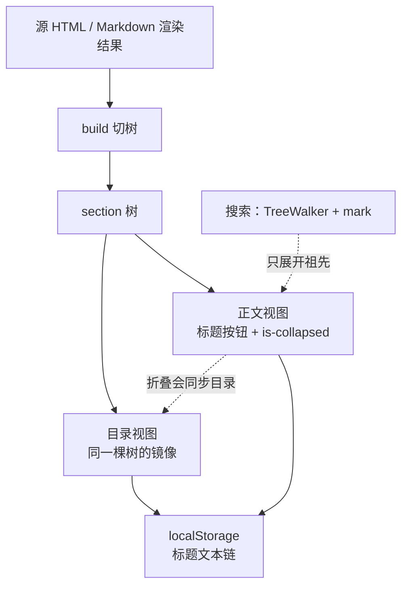
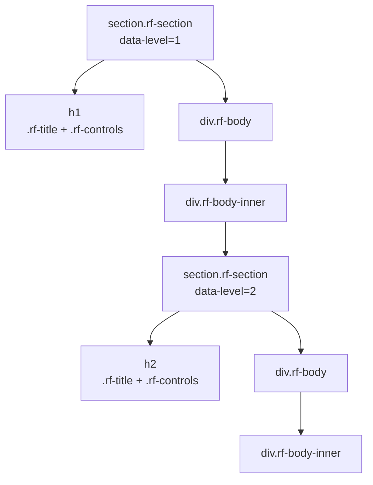
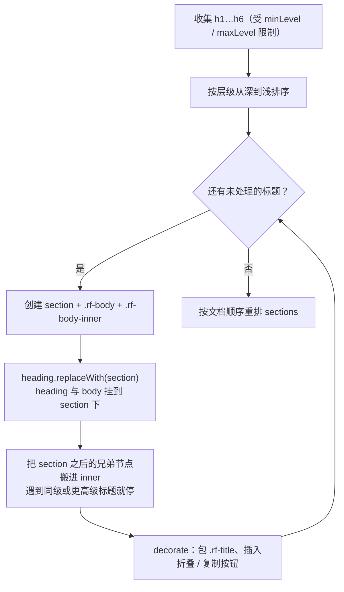
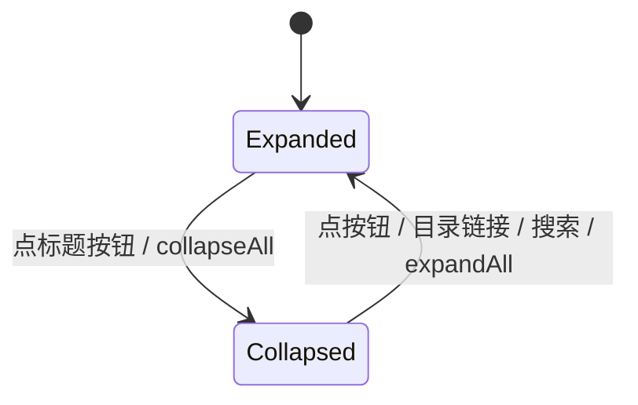
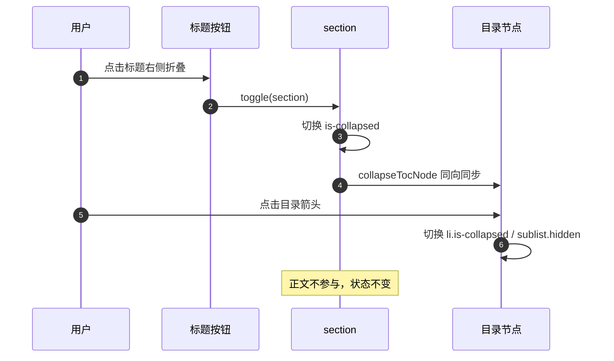
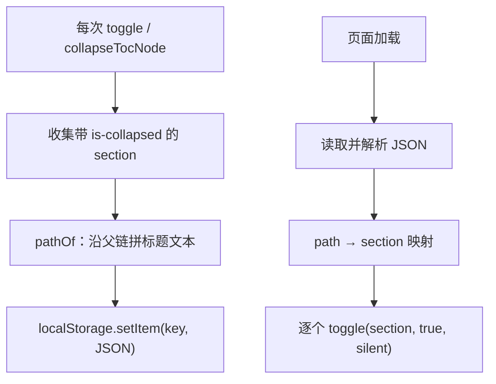
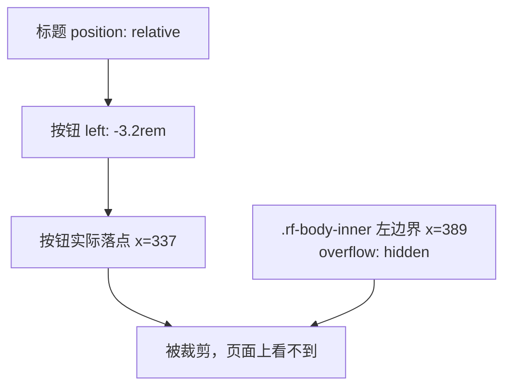
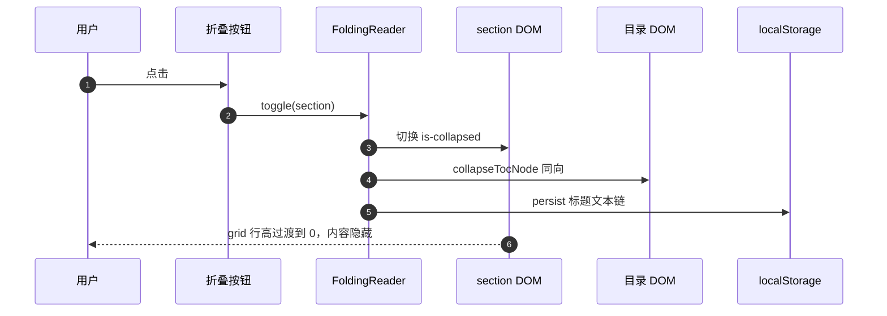

# 实现原理

这份文档说明 FoldingReader 内部怎么把一段普通 HTML 变成可折叠的阅读视图，以及每个环节的设计取舍。
源码只有 `reader.js` 一个文件，约 450 行，下面按「总览 → 数据结构 → 三个关键流程 → 边界」展开。

## 1. 总览

整条链路只做一件事：**在渲染之后重写一次 DOM 结构**，把线性的标题序列变成嵌套的 section 树，之后所有的折叠、目录、搜索都挂在这棵树上。



关键点：目录、折叠、搜索**共享同一棵树**，所以「父节点折叠，子节点自动不可见」这类规则用 CSS 就成立，不需要三份状态互相同步。

## 2. 数据结构

切树完成后的 DOM 形态：



| 结构 | 作用 |
| --- | --- |
| `section` | 折叠的最小单位，`is-collapsed` 挂在这一层 |
| `heading` | 保留原标题标签与 `id`，深链接仍然有效 |
| `.rf-title` | 标题文本的包裹层，让按钮可以固定在标题行右侧 |
| `.rf-body > .rf-body-inner` | 两层是为了用 grid 行高做高度过渡，外层负责过渡、内层负责裁剪 |
| `.rf-controls` | 折叠 / 复制按钮，位于标题行内，不参与正文流 |

JS 侧只维护三份轻量索引，全部由这棵 DOM 派生，不单独存数据：

| 索引 | 类型 | 用途 |
| --- | --- | --- |
| `meta` | `WeakMap<section, {heading, level}>` | 从 section 反查标题与层级，不阻止节点回收 |
| `tocNodes` | `Map<section, {li, row, toggle, sublist}>` | 正文与目录的双向定位 |
| `sections` | `Array<section>` | 按文档顺序排列，供批量操作使用 |

标题级别记录在 `data-level` 中，章节归属由 DOM 的嵌套关系表示。两者不一定相等：例如 H1 后直接接 H3，H3 仍是三级标题，但可以直接嵌在 H1 的章节里。

## 3. 切树：从最深的标题往上包

### 标题识别与章节归属

折叠依赖两层契约，**不依赖某一种 HTML 标签**：

| 契约 | 要回答的问题 | 当前 Demo 的规则 |
| --- | --- | --- |
| 标题识别 | 哪个节点是标题？它是第几级？ | 识别 `h1`–`h6`，从标签名读取级别；默认只给 H1–H3 生成可折叠章节。 |
| 章节归属 | 折叠这个标题时，要隐藏哪些内容？ | 从标题往后收集同一父容器里的兄弟节点，遇到下一个同级或更高级标题就停止。 |

标题语义也可以由属性表达。例如，`<h2>安装</h2>`、`<div role="heading" aria-level="2">安装</div>`，以及飞书页面里可见的 `<div data-block-type="heading2">安装</div>`，都可以在各自的契约里表示二级标题。**当前 Demo 只直接识别第一种**，不根据字号、粗体或类名猜测标题，也没有内置对 ARIA 标题或飞书块的适配。

如果要适配另一种输入，可以先把标题和层级规范化为 `h1`–`h6`，再交给现有阅读器。如果输入按块组织，也可以用明确的父子块关系定义章节范围；**只改标题选择器，不会让折叠自动跨容器**。例如 `<div><h2>安装</h2></div><p>安装步骤</p>` 中，段落不在标题的父容器里，折叠标题不会隐藏它；把标题和段落一起放进同一个 `<div>`，则可以正常折叠。

### 构建流程

当前实现**按层级从深到浅**逐个处理标题，而不是按文档顺序：



这版实现从深到浅，是为了让 H2 处理兄弟节点时，已经构建好的 H3 章节能作为一个整体搬入。也可以用按文档顺序扫描的栈算法来构建同样的章节树；从深到浅是这里的实现选择，不是输入契约。

## 4. 折叠：一个类名 + 行高过渡

折叠状态只有两个值，挂在 section 上：



对应的样式：

```css
.rf-body { display: grid; grid-template-rows: 1fr; transition: grid-template-rows .2s; }
.rf-section.is-collapsed > .rf-body { grid-template-rows: 0fr; visibility: hidden; }
.rf-body-inner { min-height: 0; overflow: hidden; }
```

不用 `max-height` 是因为它必须猜一个足够大的数值，动画速度会随内容高度变化（短内容一闪而过、长内容像在爬）。
`grid-template-rows: 0fr → 1fr` 是按内容实际高度插值的，不需要测量。

`visibility` 而不是 `display: none`：`display: none` 会让高度瞬间归零，过渡直接失效；`visibility` 可以参与过渡，同时把被折叠的内容移出 Tab 焦点顺序。

## 5. 目录：同一棵树的镜像，联动是单向的

目录不是另建的一份数据结构，而是 `walkToc` 递归遍历同一棵 section 树生成的 `ul/li`。这带来两个直接结果：

- 父节点在目录里折叠，子节点靠 CSS 自动不可见，不需要 JS 同步；
- 正文折叠时，对应的目录节点要跟着收起，这是唯一需要显式写的一条规则。



方向之所以固定成「正文 → 目录」，是因为正文是事实、目录是视图：正文折叠了却让目录仍显示子节点，点进去会跳到一块看不见的内容上。
反过来，目录的折叠只是导航视图的收放，不应该改动正文——这也是组件里 `collapseTocNode()` 从不碰 section 的原因。

点目录链接时走的是另一条路径 `reveal()`：先展开整条祖先链，再滚动定位，避免“跳过去却看不见”。

## 6. 搜索：遍历文本节点 + 展开祖先


两个细节：

- 用 `Range.surroundContents()` 而不是替换 `innerHTML`，这样不会破坏已有的事件监听和节点引用；
- 清空搜索时必须 `parent.normalize()`，否则拆掉 mark 后会留下大量碎片化文本节点，反复搜索会越切越碎。

命中后展开祖先，对应飞书「⌘F 会一次性展开所有折叠标题」的行为；搜索框本身拦截 `⌘F / Ctrl+F`，因为浏览器原生查找对 `visibility: hidden` 的内容不可靠。

## 7. 持久化：存标题文本链，不存自增 id



键长这样：`3. 实现原理 / 3.1 结构映射`。

不用 section 序号（`rf-s12`）是因为内容增删会让序号整体位移，恢复出来的折叠状态会错位到别的章节；标题文本链只在标题被改写时失效，语义上更稳。
读取失败（隐私模式、`file://` 限制）时静默降级，不影响阅读。

## 8. 布局：按钮为什么在标题右侧

折叠按钮最早是放在标题左侧留白里的（`position: absolute; left: -3.2rem`），视觉上更像飞书。但它被裁掉了：



绝对定位元素的裁剪跟随包含块：按钮的包含块是标题，标题在 `.rf-body-inner` 内部，所以内层的 `overflow: hidden`（折叠动画需要）会把伸出去的部分裁掉。H1 的按钮在容器外一点，勉强能看见，H2/H3 全部消失。

最终改成标题行内布局：标题是 flex 容器，`.rf-title` 占左侧、`.rf-controls` 固定在右侧，按钮完全落在容器内部，既不会被裁，也不受滚动影响。默认透明度 0.35 保证可发现性，悬停变清晰，折叠时加深到 0.9 提示可展开。

## 9. 边界与取舍

| 场景 | 处理 |
| --- | --- |
| 标题和正文有包装容器 | 可以共用外层容器；切树不会跨父容器，目录能穿过包装层读取已生成的章节 |
| 标题层级超过 `maxLevel` | 保留为普通标题，不折叠、不进目录 |
| 打印 | 折叠内容不可见，`beforeprint` 时调 `expandAll()` |
| `localStorage` 不可用 | 静默降级，折叠照常工作，只是不记忆 |
| 段落内多次命中关键词 | 每个文本节点只标第一处，避免反复切分文本节点 |
| 需要边写边折 / 协同 | 超出范围，应改用 Tiptap 这类编辑器内核 |

## 10. 一次点击的完整链路



从点击到落盘共 4 步，没有异步、没有重绘等待，状态全部落在 DOM 类名上——这也是刷新后能靠重放类名恢复的原因。
